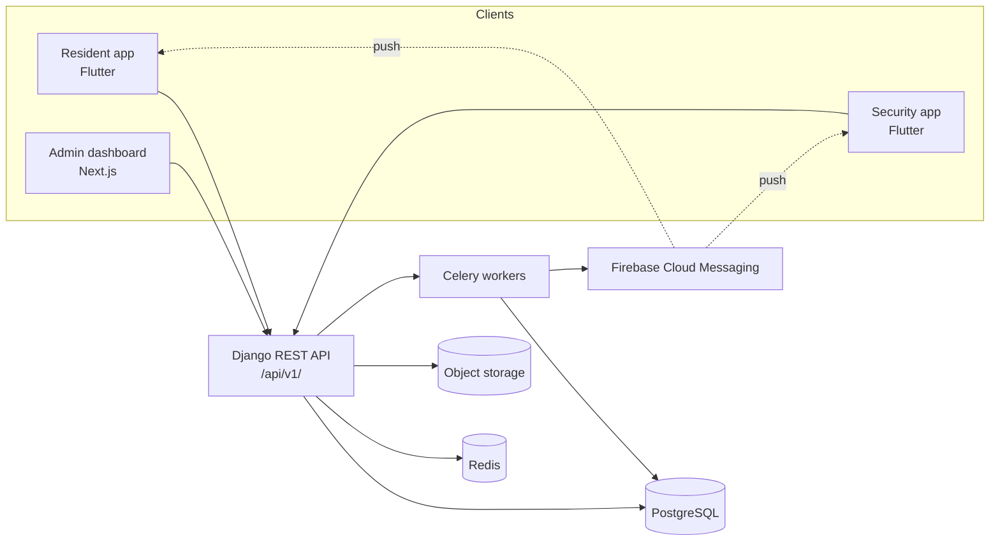

# System Architecture (Phase 1-2)

Status: draft for approval. Where this document extends the master skill it is marked **[proposed]**.

## Components

The backend is the single source of truth. Clients never touch the database and never make access decisions.

## Backend layering

Per Django app: `models` -> `services` (business rules, transactions) -> `serializers` (validation) -> `views` (thin) -> `permissions`. Views never contain access logic.

Apps follow the master skill: authentication, users, estates, properties, residents, visitors, access_control, gate_management, notifications, reports, audit_logs, system_settings.

## Estate isolation

- Every estate-owned table carries `estate_id`.
- A base queryset/manager scopes every query to the caller's estate memberships. Unscoped access requires an explicit, audited opt-out (Super Administrator only).
- Object-level permission check on every detail route; list routes are scoped, never filtered client-side.
- Each endpoint ships with negative tests: other estate, other resident, wrong role.

## Credentials [proposed details]

- **QR token**: 32 random bytes from `secrets`, URL-safe encoded, plus a truncated HMAC signature tag. The tag is checked first, so a forged or altered QR is rejected before any database lookup (proposal section 4.2). The payload carries no personal data.
- **Numeric code**: configurable length, default 8 digits, generated with `secrets`. Decided: 8 digits (Q2).
- **Storage**: only `HMAC-SHA256(server_pepper, token)` is stored, never the token. HMAC (not bcrypt) is used because lookup is by value and the QR token is high entropy. The pepper lives in environment configuration and is rotatable.
- **Scoping**: lookup is always `(estate_id, token_hash)`. `estate_id` comes from the officer's active shift, not from the request body. A partial unique index on `(estate_id, token_hash)` for active credentials detects collisions.
- **Guessing defence for numeric codes**: rate limit per device and per officer, lockout after repeated failures, every failure written to `AccessEvent` as `REJECTED_ENTRY`, short validity windows.
- Because only the hash is stored, the server cannot re-display an existing pass. The plaintext is returned once at generation. How a resident re-opens a pass later is decided (Q11): the app keeps it in secure storage, and "reissue" revokes the old credential and creates a new one.

## Verification and admission

Two endpoints, deliberately separate, so a scan never consumes a credential.

1. `POST /gate/verify/` is read-only. It runs the validation order from the master skill (section 8.4) and returns an outcome plus the minimum display data. It writes an audit/rejection record when the outcome is a rejection.
2. `POST /gate/check-in/` is the commit. In one transaction it locks the credential row (`select_for_update`), re-runs all validation, increments `uses_count`, sets status to consumed at the limit, creates the `ENTRY` event and queues the resident notification. If any step fails nothing is committed. An `Idempotency-Key` header makes retries from a flaky network safe.
3. `POST /gate/check-out/` finds the open entry for the visitor/invitation, creates an `EXIT` event referencing it, and rejects exits with no open entry.

Outcomes: `VALID, EXPIRED, CANCELLED, REVOKED, ALREADY_USED, NOT_YET_VALID, INVALID, ALREADY_CHECKED_IN, REQUIRES_MANUAL_REVIEW`. To an unauthorised caller, unknown and wrong-estate credentials both return `INVALID` so the response does not reveal that a credential exists elsewhere. The officer UI maps outcomes to the reasons in master skill section 10.

Manual override is a separate permissioned action requiring a justification, creating a `MANUAL_OVERRIDE` event and an audit record, with optional supervisor approval.

## Offline behaviour (decided, Q3)

Fail closed. If the gate app cannot reach the backend it shows an explicit offline state and does not admit by app. Admission while offline goes through the manual process and is entered as an override once connectivity returns.

## Authentication

Passwords hashed with Argon2. Two-factor authentication is required for every dashboard account. Password recovery uses a one-time code by SMS. Users can see sessions and sign out remotely. Simple JWT with short-lived access tokens and rotating refresh tokens, blacklist on logout, suspension and password reset. Tokens in flutter_secure_storage (Android Keystore) on mobile. The dashboard keeps tokens in httpOnly cookies behind its own Next.js route handlers, not in `localStorage`. Gate devices are registered (`GateDevice`), and security logins are bound to an active `SecurityShift` and device. Rate limiting on login, password recovery and verification.

## Notifications

Events are written as `Notification` rows in the same transaction as the business change, then a Celery task sends the FCM push. Dedupe key per (user, event, object). Invalid FCM tokens are deactivated on error responses. Push is informational only; it is never proof that an operation succeeded.

## Realtime

Dashboard gate monitoring uses polling (default 10 s) and is labelled as polling in the UI. WebSockets are out of scope for the first release.

## Auditing

An append-only `AuditLog`: the application database role has no UPDATE or DELETE on the table, and the Django admin exposes it read-only. Written from the service layer, so every code path is covered. Covers the events listed in master skill section 11.

## Environments and deployment [proposed, needs approval]

The proposal commits to the Estate's own cloud account (AWS, Azure or GCP), provisioned with Terraform, provider agreed in discovery. Everything below must run there.

| Piece | Proposal |
|---|---|
| Backend + Celery + Redis | Docker containers; Terraform for the environment |
| PostgreSQL | Managed Postgres with automated backups and point-in-time recovery |
| ID documents | Private object storage, per-file encryption with the provider's key service |
| Admin dashboard | Container or provider-native hosting (Vercel only if the Estate agrees) |
| Mobile builds | Flutter release builds (Android App Bundle) signed and published to Play Store from CI |
| CI/CD | GitHub Actions: lint, type-check, tests, migration check, build |
| Secrets | Environment variables, `.env.example` in each app, never committed |
| Monitoring | Sentry plus uptime checks; backend latency metrics against the 2 s verify target |

## Multi-estate

Schema and queries are estate-scoped from day one; the first release can run a single estate. No cross-estate features are built until needed.
