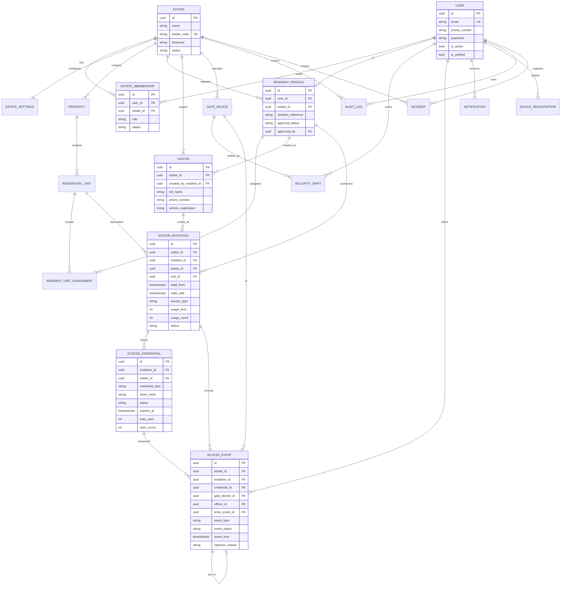

# Database Design and ERD (Phase 2)

PostgreSQL via the Django ORM. Custom user model from the first migration. Externally exposed IDs are UUIDs.

Entities marked **[proposed]** extend the master skill's model list; fields marked **[proposed]** are additions to its field lists. Everything else matches the master skill.

Remaining entities (`Property`, `ResidentialUnit`, `ResidentUnitAssignment`, `GateDevice`, `SecurityShift`, `Notification`, `AuditLog`, `EstateSettings`) follow the master skill field lists exactly and are omitted from the field blocks above only for readability.

## Proposed additions

| Addition | Why |
|---|---|
| `EstateMembership` (user, estate, role, status) | Roles are estate-scoped; managers are limited to assigned estates; supports multi-estate later. `User.role` becomes the platform-level role only (super administrator or none). |
| `Visitor.estate_id`, `Visitor.created_by_resident_id` | Prevents one resident reaching another's visitor records. |
| `AccessCredential.estate_id` | Estate-scoped credential lookup at the gate. |
| `AccessEvent.entry_event_id` (self FK, EXIT only) | Links an exit to its original entry. |
| `Incident` (estate, reported_by, gate_device, severity, description, status, created_at) | Needed by the gate incident API and the dashboard Incidents module. |
| `DeviceRegistration` (user, platform, push_token, last_seen_at, is_active) | FCM tokens, invalid-token handling. |
| `AuditLog` extras: `object_label` optional | Readable audit entries without joins. Low priority. |

## Constraints and indexes

- `ResidentialUnit`: unique `(property_id, block, unit_number)`.
- `ResidentUnitAssignment`: at most one active primary assignment per resident; no overlapping active assignment to the same unit.
- `AccessCredential`: partial unique `(estate_id, token_hash)` where status is active; check `uses_count <= max_uses`.
- `VisitorInvitation`: check `valid_until > valid_from`; check `usage_count <= usage_limit` where a limit is set.
- `AccessEvent`: partial unique on `entry_event_id` for EXIT rows (one exit per entry); at most one open entry per invitation (an ENTRY with no linked EXIT), enforced in the check-in transaction and by constraint where PostgreSQL allows.
- Indexes: `AccessEvent(estate_id, event_time desc)`, `(gate_device_id, event_time desc)`, `(invitation_id)`; `VisitorInvitation(estate_id, status, valid_until)`, `(resident_id, created_at desc)`; `Notification(user_id, read_at)`; `AuditLog(estate_id, created_at desc)`, `(actor_id, created_at desc)`.

## Data handling

- `AuditLog`, `AccessEvent` and invitations are preserved; retention follows `EstateSettings` and an approved process. No hard deletes on these.
- Soft deletion only for users and residential records where history must be kept.
- `identification_reference` stays minimal and is encrypted at rest if it must be kept at all.
- Status fields are enums with database check constraints. All timestamps are `timestamptz`, displayed in the estate timezone.
- State changes that must be atomic (credential consumption, check-in, approval) happen inside `transaction.atomic()` in the service layer.
